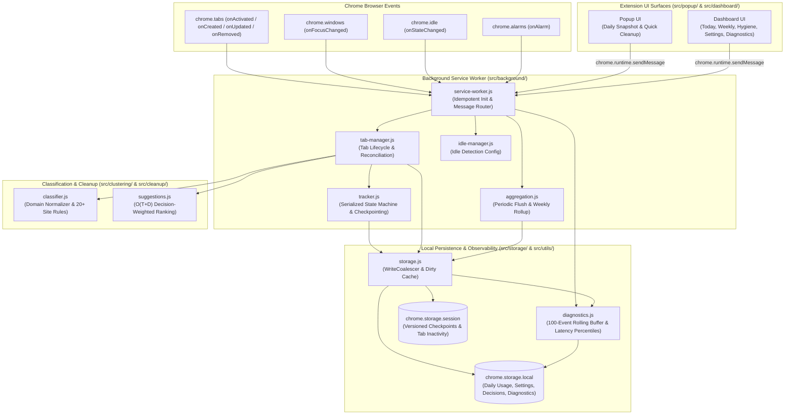
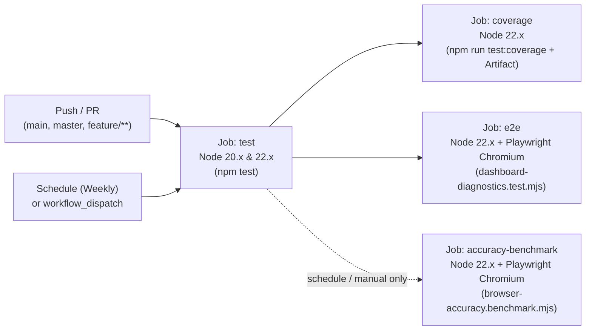

<p align="center">
  
</p>

<h1 align="center">Web-Usage-Tracker (WebTrack)</h1>

<p align="center">
  <strong>Event-driven active browser usage tracking and decision-weighted tab cleanup for Chrome Manifest V3.</strong>
</p>

<p align="center">
  
  
  
  
  
</p>

<p align="center">
  <a href="https://github.com/Bhavadharani412/Web-Usage-Tracker">Repository</a> ·
  <a href="https://deepwiki.com/Bhavadharani412/Web-Usage-Tracker">DeepWiki</a> ·
  <a href="https://github.com/Bhavadharani412/Web-Usage-Tracker/actions/workflows/test.yml">CI Runs</a> ·
  <a href="https://github.com/Bhavadharani412/Web-Usage-Tracker/issues">Issues</a> ·
  <a href="./PRIVACY.md">Privacy Policy</a>
</p>

---

## Project Overview

**Web-Usage-Tracker (WebTrack)** is a local-first Chrome Manifest V3 extension that measures actual active browsing time, clusters related URLs into website categories, and provides user-controlled tab cleanup recommendations.

Conventional browser timers often conflate open tab duration with active engagement, lose in-progress session data when Chrome terminates background service workers, or require external cloud telemetry. WebTrack addresses these engineering problems through four core design mechanisms:

- **Strict Active-Time Accounting:** Time accumulates only when the browser window is focused, the tab is active, and the user is not idle (`chrome.idle`).
- **Service-Worker Suspension Resilience:** State transitions (`startSession`, `pause`, `resume`) write versioned checkpoints to `chrome.storage.session`, allowing the background service worker to recover active sessions across forced suspensions without data loss.
- **Bounded Storage Coalescing:** Rapid tab-switching events are buffered in memory and flushed within bounded time windows (`150ms` debounce, `800ms` max hold), reducing physical storage write operations by 99.95% under high-frequency switching while preserving read-your-own-writes consistency.
- **Decision-Weighted Tab Cleanup:** Inactive tabs are evaluated in $O(T + D)$ time using historical keep/close decisions and strict protected-domain precedence, never auto-closing tabs without explicit user confirmation.

WebTrack is built for developers, researchers, and privacy-conscious users who want accurate local insight into browser usage and structured tab hygiene without external network transmission.

---

## Technical Architecture

WebTrack is structured into five decoupled layers inside a zero-build ES module architecture: **Browser Event Sources**, **Background Service Worker**, **Classification Pipeline**, **Persistence Layer**, and **UI Surfaces**.



### Component Responsibilities & Data Flow

1. **Background Service Worker (`src/background/`):**
   - [`service-worker.js`](src/background/service-worker.js): Registers Chrome event listeners, coordinates idempotent startup (`initialize()`), and routes asynchronous UI messages (`GET_TODAY_USAGE`, `GET_WEEKLY_DATA`, `GET_INACTIVE_TABS`, `CLOSE_TABS`, `KEEP_TABS`, `GET_DIAGNOSTICS`, `RECONCILE_TABS`).
   - [`tracker.js`](src/background/tracker.js): Implements a deterministic state machine (`INACTIVE`, `TRACKING`, `PAUSED`) backed by a serialized FIFO promise queue (`_enqueue`). Prevents concurrent event interleaving, enforces at most one active session ($N_{\text{active}} \le 1$), splits sessions across midnight boundaries (`splitSessionSegmentsByDay`), and attaches monotonic `checkpointVersion` numbers.
   - [`tab-manager.js`](src/background/tab-manager.js): Maintains the live tab map, tracks `inactiveSince` timestamps, responds to window focus and system idle transitions, and executes conservative runtime reconciliation (`reconcileTabs()`) to prune orphaned tab records.
   - [`aggregation.js`](src/background/aggregation.js): Manages `chrome.alarms` (`wt_periodic_aggregation` every 5 minutes, `wt_hourly_maintenance` every 60 minutes) and aggregates daily records into weekly rollups.

2. **Storage & Persistence (`src/storage/`):**
   - [`storage.js`](src/storage/storage.js) & [`schema.js`](src/storage/schema.js): Wraps `chrome.storage.local` (daily summaries `wt_daily_YYYY-MM-DD`, user settings `wt_settings`, tab decisions `wt_tab_decisions`, diagnostics `wt_diagnostics`) and `chrome.storage.session` (active session checkpoints `wt_active_session` and tab inactivity `wt_tab_inactivity`).
   - **Read-Your-Own-Writes Cache:** `getTabInactivity()` overlays pending in-memory coalesced updates onto persisted session state so callers always observe immediate consistency.

3. **URL Clustering & Cleanup Engine (`src/clustering/`, `src/cleanup/`):**
   - [`classifier.js`](src/clustering/classifier.js), [`domain-normalizer.js`](src/clustering/domain-normalizer.js), & [`site-rules.js`](src/clustering/site-rules.js): Normalizes hostnames, separates Google service subdomains (`mail.google.com`, `docs.google.com`, `drive.google.com`), categorizes 20+ known platforms with page-type matching, and filters internal browser URLs (`chrome://`, `chrome-extension://`, `about:`).
   - [`suggestions.js`](src/cleanup/suggestions.js) & [`cleanup-ui.js`](src/cleanup/cleanup-ui.js): Computes domain keep ratios from stored user decisions in a single batch and renders the shared checkbox review interface.

4. **Frontend UI (`src/popup/`, `src/dashboard/`):**
   - [`popup.js`](src/popup/popup.js): Renders live tracking status, today's top categories, first-run onboarding overlay, and inline inactive tab review.
   - [`dashboard.js`](src/dashboard/dashboard.js): Provides five view panels — **Today**, **Weekly** (with like-for-like partial-week comparisons), **Tab Hygiene**, **Settings** (thresholds, protected domain whitelist, storage usage), and **Diagnostics**.

---

## Features and Engineering Capabilities

| Capability | Implementation Mechanism | Failure & Privacy Handling |
| :--- | :--- | :--- |
| **Serialized State Machine & Checkpointing** | [`tracker.js`](src/background/tracker.js) serializes `init`, `startSession`, `pause`, `resume`, and `endSession` through `_enqueue()`. Checkpoints store `version`, `tabId`, `startTime`, and `segments` in `chrome.storage.session`. | Stale checkpoint writes with `version < lastAcknowledgedCheckpointVersion` are rejected. On service-worker wake-up, `chrome.tabs.get` verifies tab liveness before restoring or flushing. |
| **Bounded Write Coalescing & Tab Reconciliation** | [`storage.js`](src/storage/storage.js) buffers `persistTabInactive` / `clearTabInactive` calls for `150ms` (up to `800ms` max hold). [`tab-manager.js`](src/background/tab-manager.js) reconciles tracked tabs against `chrome.tabs.query({})`. | If a storage write fails, dirty entries remain in memory for retry on the next flush. If `chrome.tabs.query` throws, `reconcileTabs()` aborts conservatively without deleting tracked state. |
| **Decision-Weighted Tab Cleanup** | [`suggestions.js`](src/cleanup/suggestions.js) aggregates historical decisions in $O(D)$ (`aggregateDomainDecisions`) and ranks candidate tabs in $O(T)$ (`rankCleanupCandidates`). Suppresses domains with $\ge 80\%$ keep ratio once $\ge 5$ decisions exist. | Protected domains (`protectedDomains`), pinned tabs, and audible tabs are filtered first with zero false suppression. Domains with $< 5$ decisions are never suppressed prematurely. |
| **Midnight-Accurate & Like-for-Like Analytics** | [`time-format.js`](src/utils/time-format.js) splits active segments spanning `00:00:00` local time across calendar dates (`splitSegmentByDay`). Weekly reports compare identical elapsed weekdays. | Prevents multi-hour overnight sessions from skewing a single day and eliminates artificial week-over-week percentage drops early in the week. |
| **Local Extension Health Diagnostics** | [`diagnostics.js`](src/utils/diagnostics.js) records service-worker recovery outcomes, storage write latencies (`p50`/`p95`), and deduplicated runtime error counts in a 100-event FIFO rolling buffer. | `sanitizeText()` strips URLs, domain names, and paths before storage (`[redacted_url]`, `[redacted_domain]`). Persistence is guarded against recursion and never blocks tracking. |

### Scope Note (Implemented vs. Maintenance Lifecycle)
- **Implemented:** Event-driven tracking, monotonic session checkpointing, bounded write coalescing, runtime tab reconciliation, $O(T + D)$ decision-weighted cleanup suggestions, daily/weekly reports, and local health diagnostics.
- **Current Retention Behavior:** `checkDayRollover()` in [`aggregation.js`](src/background/aggregation.js) defines the 90-day retention boundary (`DATA_RETENTION_DAYS = 90`); users can also clear all stored tracking or diagnostic data at any time from the Dashboard.

---

## Technology Stack

- **Runtime & Language:** JavaScript (ES2022+ ES Modules), HTML5, CSS3
- **Extension Platform:** Chrome Extensions Manifest V3 (`service_worker`, `chrome.tabs`, `chrome.windows`, `chrome.idle`, `chrome.alarms`, `chrome.storage.local`, `chrome.storage.session`)
- **Unit, Concurrency & Coverage Testing:** Node.js native test runner (`node:test`, `node:assert/strict`, `--experimental-test-coverage`) with custom Chrome API mocks ([`tests/mock-chrome.mjs`](tests/mock-chrome.mjs))
- **Browser Automation & E2E Testing:** Playwright (`playwright` `^1.64.1`) running headless Chromium
- **CI/CD:** GitHub Actions (`.github/workflows/test.yml`)

---

## CI/CD and Quality Assurance

Continuous integration is defined in [`.github/workflows/test.yml`](.github/workflows/test.yml) (**WebTrack CI Test Suite**) with least-privilege `contents: read` permissions and explicit job timeouts.



### Pipeline Stages

1. **Unit, Concurrency & Storage Tests (`test`):** Runs across Node.js `20.x` and `22.x` on `ubuntu-latest` (`timeout-minutes: 10`). Executes `npm ci` and `npm test`, validating classifier rules, midnight session splitting, weekly aggregation, tracker concurrency invariants, storage write coalescing, decision-weighted cleanup ranking, diagnostics buffer bounds, and synthetic benchmarks.
2. **Test Coverage & Quality Gates (`coverage`):** Runs on Node.js `22.x` after `test` succeeds. Executes `npm run test:coverage` and uploads `coverage-report-node22` (`retention-days: 14`).
3. **Playwright UI Critical Path Tests (`e2e`):** Runs on Node.js `22.x` after `test` succeeds (`timeout-minutes: 10`). Installs Playwright-managed Chromium (`npx playwright install --with-deps chromium`) and executes [`tests/playwright/dashboard-diagnostics.test.mjs`](tests/playwright/dashboard-diagnostics.test.mjs) against an ephemeral local HTTP server with guaranteed `try / finally` and `t.after()` socket/browser teardown.
4. **Ground-Truth Browser Accuracy Benchmark (`accuracy-benchmark`):** Triggered via weekly cron schedule (`0 3 * * 1`) or manual `workflow_dispatch` (`timeout-minutes: 15`). Runs the 10-iteration controlled 90-second browser accuracy benchmark ([`tests/playwright/browser-accuracy.benchmark.mjs`](tests/playwright/browser-accuracy.benchmark.mjs)) and archives `accuracy-benchmark-log`.

---

## Documentation and Repository Navigation

| Resource | Link / Location | Description |
| :--- | :--- | :--- |
| **GitHub Repository** | [github.com/Bhavadharani412/Web-Usage-Tracker](https://github.com/Bhavadharani412/Web-Usage-Tracker) | Source code, branches, and releases |
| **DeepWiki Documentation** | [deepwiki.com/Bhavadharani412/Web-Usage-Tracker](https://deepwiki.com/Bhavadharani412/Web-Usage-Tracker) | AI-indexed architectural documentation and module exploration |
| **GitHub Wiki** | [github.com/Bhavadharani412/Web-Usage-Tracker/wiki](https://github.com/Bhavadharani412/Web-Usage-Tracker/wiki) | Repository wiki and supplementary guides |
| **CI Workflow Runs** | [Actions — WebTrack CI Test Suite](https://github.com/Bhavadharani412/Web-Usage-Tracker/actions/workflows/test.yml) | Live execution logs and coverage/benchmark artifacts |
| **Issue Tracker** | [GitHub Issues](https://github.com/Bhavadharani412/Web-Usage-Tracker/issues) | Bug reports, feature requests, and engineering roadmap |
| **Engineering Specs & Reports** | [`docs/engineering/`](docs/engineering/) | [`BASELINE_AUDIT.md`](docs/engineering/BASELINE_AUDIT.md), [`IMPLEMENTATION_PLAN.md`](docs/engineering/IMPLEMENTATION_PLAN.md), [`TEST_STRATEGY.md`](docs/engineering/TEST_STRATEGY.md), [`ACCURACY_REPORT.md`](docs/engineering/ACCURACY_REPORT.md), [`ADR_001_COORDINATED_HARDENING.md`](docs/engineering/ADR_001_COORDINATED_HARDENING.md) |
| **Privacy & Contribution** | [`PRIVACY.md`](PRIVACY.md) · [`CONTRIBUTING.md`](CONTRIBUTING.md) | Local-first privacy commitments, permissions, and contributor workflow |

---

## Installation and Local Development

### Prerequisites

- **Node.js:** `v20.x` or `v22.x`+ (with `npm`)
- **Browser:** Google Chrome or Chromium (`Manifest V3` support)
- **Git**

### 1. Clone and Install Dependencies

```bash
git clone https://github.com/Bhavadharani412/Web-Usage-Tracker.git
cd Web-Usage-Tracker
npm ci
```

*(No environment variables, external API keys, or build/transpilation steps are required; the extension runs native ES modules directly).*

### 2. Install Playwright Chromium (For UI & Accuracy Tests)

```bash
npx playwright install chromium
```

### 3. Load Unpacked Extension in Chrome

1. Open Chrome and navigate to `chrome://extensions/`.
2. Enable **Developer mode** in the top-right corner.
3. Click **Load unpacked** and select the root `Web-Usage-Tracker` directory (containing [`manifest.json`](manifest.json)).
4. Pin **WebTrack** to the Chrome toolbar to access the popup and dashboard.

---

## Project Structure

```text
Web-Usage-Tracker/
├── .github/workflows/
│   └── test.yml                  # CI pipeline (Unit, Coverage, Playwright E2E, Accuracy Benchmark)
├── assets/                       # Extension icons (16px, 48px, 128px)
├── docs/engineering/             # Engineering audits, ADRs, test strategy, and accuracy reports
├── src/
│   ├── background/               # Service worker entry point, state machine, tab & idle managers, aggregation
│   ├── cleanup/                  # O(T+D) decision-weighted suggestion engine & shared review UI
│   ├── clustering/               # Domain normalizer, 20+ site classification rules, URL classifier
│   ├── dashboard/                # Full-page analytics, tab hygiene, settings, and diagnostics UI
│   ├── popup/                    # Toolbar popup snapshot, onboarding overlay, and quick cleanup UI
│   ├── storage/                  # Chrome storage wrapper, bounded WriteCoalescer, and data schemas
│   └── utils/                    # Local health diagnostics manager, browser adapter, and date/time math
├── tests/
│   ├── playwright/               # Real-browser Playwright UI tests and 90s ground-truth accuracy harness
│   └── *.test.mjs                # Node.js unit, concurrency, storage, classifier, and benchmark suites
├── CONTRIBUTING.md               # Development and pull request guidelines
├── PRIVACY.md                    # Privacy policy and Chrome permission justifications
├── manifest.json                 # Chrome Manifest V3 extension configuration
└── package.json                  # Scripts and Playwright devDependency
```

---

## Testing and Contribution

### Test Commands

All scripts in [`package.json`](package.json) are verified against the Node.js test runner and Playwright:

```bash
# Run all unit, concurrency, storage, cleanup, and synthetic benchmark suites (52 tests)
npm test

# Run unit, concurrency, storage, and cleanup tests without synthetic benchmarks
npm run test:unit

# Run test suite with line and branch coverage reporting
npm run test:coverage

# Run Playwright dashboard diagnostics E2E UI tests
npm run test:e2e

# Run 10-iteration real-browser ground-truth accuracy benchmark
npm run test:accuracy

# Run both synthetic and real-browser benchmarks
npm run test:benchmarks
```

### Contributing

Contributions that improve tracking accuracy, storage efficiency, accessibility, or test coverage are welcome:

1. Review [`CONTRIBUTING.md`](CONTRIBUTING.md) and check open [GitHub Issues](https://github.com/Bhavadharani412/Web-Usage-Tracker/issues).
2. Create a focused branch (`git checkout -b fix/your-change` or `feat/your-feature`).
3. Ensure all changes preserve WebTrack's local-first privacy guarantees (no external network requests or URL leakage).
4. Run `npm test` and `npm run test:e2e` locally and verify all tests pass before opening a pull request.

---

## License

Released under the [MIT License](LICENSE).
