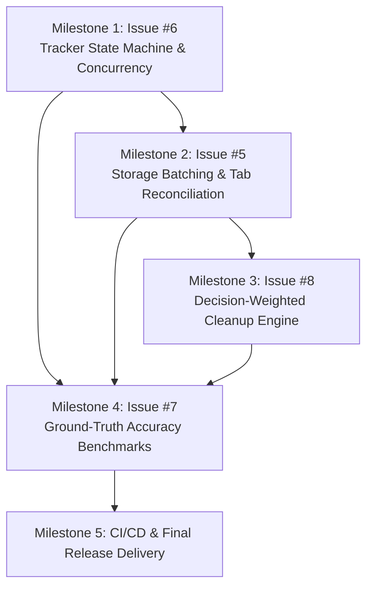

# WebTrack Coordinated Implementation Plan
**Authoritative Standards:** [AGENTS.md](../../AGENTS.md)  
**Scope:** Issues #5, #6, #7, #8  
**Branch:** `feature/webtrack-production-hardening`

---

## 1. Architectural Strategy & Phasing

To ensure data integrity, correctness, and traceable verification, the four issues are sequenced along their strict dependency boundaries:

1. **Milestone 1 (Issue #6):** Establish deterministic tracker state transitions, serialized event processing queue, monotonic checkpoint versioning, and idempotency.
2. **Milestone 2 (Issue #5):** Implement bounded write coalescing in `storage.js`, read-your-own-writes cache, and runtime tab reconciliation in `tab-manager.js`.
3. **Milestone 3 (Issue #8):** Implement $O(T + D)$ decision-weighted cleanup candidate filtering and ranking with configurable sample thresholds and protected domain precedence.
4. **Milestone 4 (Issue #7):** Build real-browser Playwright ground-truth benchmark suite, execute $\ge 10$ controlled runs, calculate MAE/MedAE, and compile `ACCURACY_REPORT.md`.
5. **Milestone 5 (CI/CD & Delivery):** Update `.github/workflows/test.yml`, package scripts, verify full regression suite, and compile final delivery report.

---

## 2. Milestone 1: Issue #6 — Tracker State Machine & Concurrency Safety

### 2.1 Problem Statement & Root Cause
Asynchronous events (`onTabActivated`, `onWindowFocusChanged`, `onIdleStateChanged`) execute concurrently. In `tracker.js`, `startSession` awaits `endSession()`. A concurrent event during that asynchronous tick can start or pause a session out of order, leading to duplicate active sessions, split-brain states, or race conditions during checkpointing.

### 2.2 Proposed Architectural Changes
1. **Explicit State Transition Matrix:**
   - Define valid states: `INACTIVE`, `TRACKING`, `PAUSED`.
   - Table of permitted transitions:
     - `INACTIVE` $\to$ `TRACKING` (via `startSession`)
     - `TRACKING` $\to$ `PAUSED` (via `pause`)
     - `TRACKING` $\to$ `INACTIVE` (via `endSession`)
     - `PAUSED` $\to$ `TRACKING` (via `resume`)
     - `PAUSED` $\to$ `INACTIVE` (via `endSession`)
   - Any invalid transition attempt (e.g. `INACTIVE` $\to$ `PAUSED` or `TRACKING` $\to$ `PAUSED` when already paused) is safely rejected or treated as a no-op with diagnostic logging.
2. **Serialized Event Processing Queue:**
   - Implement an asynchronous FIFO execution queue in `Tracker` (`_enqueue(operation)`).
   - All state-altering methods (`init`, `startSession`, `pause`, `resume`, `endSession`) enqueue their operations onto a single promise chain, ensuring deterministic sequential execution without interleaving.
3. **Idempotent Event Handling:**
   - If `startSession(tabId, classification)` is called when `currentSession.tabId === tabId` and `categoryId` is unchanged, the tracker recognizes the duplicate invocation and treats it as a no-op, preventing spurious session tear-down and checkpoint writes.
   - Idempotent `pause()` when already `PAUSED`.
   - Idempotent `resume()` when already `TRACKING`.
4. **Monotonic Checkpoint Versioning:**
   - Attach a monotonic sequence number `checkpointVersion` to every session checkpoint written to `chrome.storage.session`.
   - When persisting, increment `checkpointVersion`. If a checkpoint write arrives with an older version than currently acknowledged, it is discarded, preventing stale checkpoint overwrites.
5. **Zero Duplicate Active Session Invariant:**
   - At any point in time, $N_{\text{active\_sessions}} \le 1$.

### 2.3 Files Affected
- `src/background/tracker.js`
- `tests/tracker.test.mjs`
- `tests/tracker-concurrency.test.mjs` (new)

---

## 3. Milestone 2: Issue #5 — Storage Batching & Stale Tab Lifecycle

### 3.1 Problem Statement & Root Cause
`persistTabInactive` and `clearTabInactive` are invoked on every tab activation and deactivation. Under rapid tab switching (1,000 events), 2,000 distinct async storage operations occur. There is no write coalescing or dirty caching, leading to write amplification, disk I/O churn, and potential quota exhaustion. Furthermore, tab lifecycle reconciliation only runs at startup, leaving orphaned references if tabs close unobserved.

### 3.2 Proposed Architectural Changes
1. **Bounded Write Coalescer (`WriteCoalescer`):**
   - Implement write coalescing for `chrome.storage.session` (tab inactivity) and `chrome.storage.local` (usage updates).
   - In-memory dirty map buffers pending key-value updates.
   - Bounded flush policy:
     - Coalescing debounce window: 200ms.
     - Maximum hold time: 1000ms (guarantees writes are not starved under sustained event traffic).
     - Explicit flush API: `flushPendingWrites()` ensures immediate persistence on session termination, worker suspend notifications, or alarms.
2. **Read-Your-Own-Writes Consistency:**
   - When `getTabInactivity()` or `get(key)` is called, the layer first inspects the pending dirty map. If a pending write exists, the un-flushed in-memory value is returned immediately.
3. **Storage Failure Recovery & Error Diagnostics:**
   - If `chrome.storage.*.set` yields a runtime error, pending writes are retained in the dirty queue for retry up to a bounded attempt count.
   - Errors are recorded via `diagnostics.recordStorageWrite(duration, false, err)` and `recordRuntimeError`.
4. **Stale Tab Runtime Reconciliation (`reconcileTabs`):**
   - Add periodic and explicit `reconcileTabs()` in `tab-manager.js`.
   - Compares live tabs from `chrome.tabs.query({})` against `tabs` Map and persisted `wt_tab_inactivity`.
   - Removes orphaned entries from memory and storage.
   - Handles browser API errors conservatively: if `chrome.tabs.query` fails or throws, abort reconciliation without clearing existing state.

### 3.3 Files Affected
- `src/storage/storage.js`
- `src/background/tab-manager.js`
- `tests/storage.test.mjs` (new)
- `tests/benchmarks.test.mjs`

---

## 4. Milestone 3: Issue #8 — Decision-Weighted Cleanup Suggestions

### 4.1 Problem Statement & Root Cause
The cleanup suggestions engine currently ranks tabs purely by inactivity duration (`inactiveSince`). Although user decisions (`keep` vs `close`) are stored in `wt_tab_decisions`, they are never utilized. Users who repeatedly keep tabs from a specific domain (e.g. `docs.google.com` or `github.com`) receive repetitive suggestions for that domain.

### 4.2 Proposed Architectural Changes
1. **Configurable Thresholds:**
   - `minDecisionSample`: Minimum decision count required before applying decision weighting (default: `5`).
   - `keepRatioThreshold`: Ratio of `keep` actions to total decisions that triggers suppression (default: `0.80` or 80%).
2. **Batched Domain Statistics Retrieval ($O(T + D)$):**
   - Retrieve all tab decisions in a single storage operation (`getTabDecisions()`).
   - Aggregate decisions into a domain summary Map:
     $$\text{domainStats} = \text{Map}\langle\text{domain}, \{\text{keepCount}, \text{closeCount}, \text{total}\}\rangle$$
     in $O(D)$ time where $D$ is the number of stored decisions.
   - Score and filter candidate tabs in $O(T)$ time where $T$ is the number of open inactive tabs.
   - Total algorithmic complexity is strictly $O(T + D)$; zero per-tab storage lookups.
3. **Decision Weighting Rules & Precedence:**
   - **Protected Domains Precedence:** Settings-configured `protectedDomains`, pinned tabs, and audible tabs are filtered first. Zero false suppression of protected domains.
   - **Insufficient Data Rule:** If $\text{total} < \text{minDecisionSample}$, the domain is NOT suppressed (insufficient evidence).
   - **Keep Ratio Rule:** If $\text{total} \ge \text{minDecisionSample}$ and $\frac{\text{keepCount}}{\text{total}} \ge \text{keepRatioThreshold}$, the tab is suppressed from suggestions.
   - **Ranking:** Unsuppressed tabs are ranked by decision score and inactivity duration.
4. **Shared Suggestion Pipeline:**
   - Centralize candidate evaluation in `src/cleanup/suggestions.js` so both the background message handler and UI components share identical, testable ranking logic.

### 4.3 Files Affected
- `src/cleanup/suggestions.js`
- `src/background/tab-manager.js`
- `src/background/service-worker.js`
- `src/storage/schema.js`
- `tests/cleanup-suggestions.test.mjs` (new)

---

## 5. Milestone 4: Issue #7 — Ground-Truth Browser Accuracy

### 5.1 Problem Statement & Objectives
Current accuracy benchmarks test synthetic stopwatch arithmetic in Node mocks. Manifest V3 Chrome extensions experience real-world timing variance due to IPC dispatch delays, service worker wake-up, and tab switching overhead. We must establish a reproducible, real-browser Playwright ground-truth benchmark suite.

### 5.2 Benchmark Design & Scenario (90-Second Controlled Timeline)
- **Environment:** Real Chromium/Chrome launched via Playwright.
- **Scenario Phases:**
  1. **Phase 1 (Tab 1 Active):** Navigate to Site A, keep active and focused for 30 seconds.
  2. **Phase 2 (Tab Switch):** Switch to Tab 2 (Site B), keep active and focused for 25 seconds.
  3. **Phase 3 (Window Blur / Inactive):** Blur window or switch away for 15 seconds (tracking pauses).
  4. **Phase 4 (Resume Tab 1):** Focus window, return to Tab 1 for 20 seconds.
  - **Ground Truth Timeline:**
    - Total Elapsed: 90.0 seconds
    - Site A Active Truth: 50.0 seconds
    - Site B Active Truth: 25.0 seconds
    - Inactive / Paused Truth: 15.0 seconds
- **Reproducibility & Statistical Rigor:**
  - Execute at least 10 valid runs.
  - Record ground truth via high-resolution performance timers in the test runner.
  - Extract extension recorded values from storage.
  - Compute:
    - Absolute Error per run: $|T_{\text{tracked}} - T_{\text{truth}}|$
    - Mean Absolute Error (MAE): $\frac{1}{N} \sum |T_{\text{tracked}} - T_{\text{truth}}|$
    - Median Absolute Error (MedAE)
    - Percentage Error: $\frac{|T_{\text{tracked}} - T_{\text{truth}}|}{T_{\text{truth}}} \times 100\%$
    - Lost Tracking Time and Duplicate Tracking Time
  - Targets:
    - MAE $< 5.0\text{s}$ for 90s scenario.
    - Median absolute error $< 2.0\text{s}$.
    - Percentage error $< 2\%$.
- **Deliverable:** Compile all results, variance, environment details, and failure logs into `docs/engineering/ACCURACY_REPORT.md`.

### 5.3 Files Affected
- `tests/playwright/browser-accuracy.benchmark.mjs` (new)
- `docs/engineering/ACCURACY_REPORT.md` (new)

---

## 6. Milestone 5: CI/CD & Verification

### 6.1 GitHub Actions Workflow Hardening
- Extend `.github/workflows/test.yml` to run:
  1. Fast unit & concurrency tests across Node 18, 20, 22.
  2. Code coverage enforcement (Tracker $\ge 90\%$, Storage $\ge 85\%$).
  3. Playwright UI tests and benchmarks.
  4. Separate scheduled or trigger-based job for long-running browser accuracy benchmarks to keep PR checks fast.

### 6.2 Documentation & Verification
- Compile `docs/engineering/PROGRESS.md`.
- Compile final delivery report with acceptance verification tables for Issues #5, #6, #7, #8.
